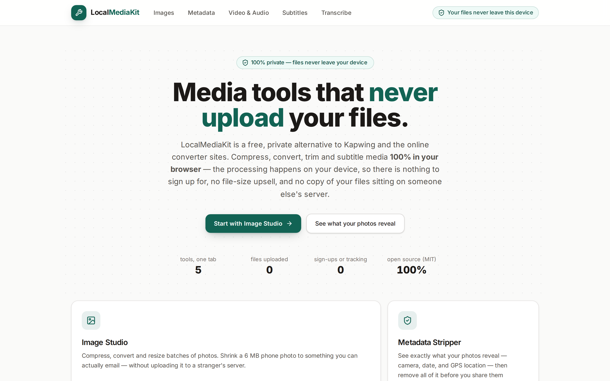
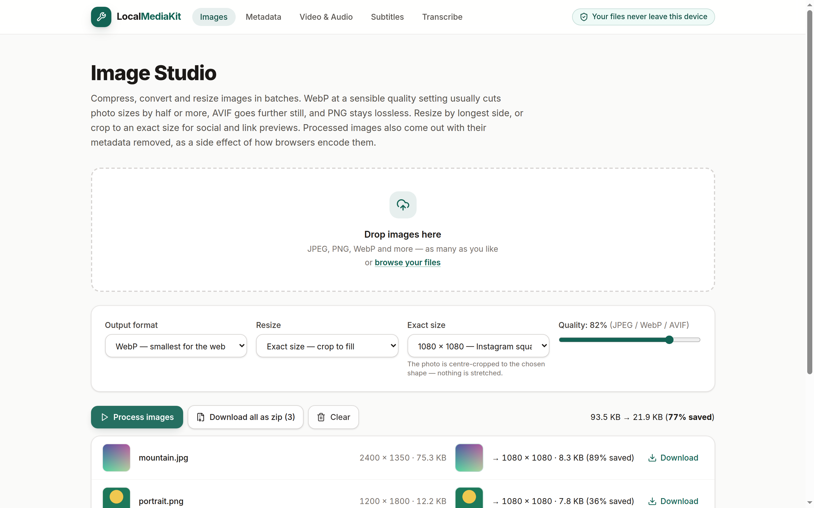
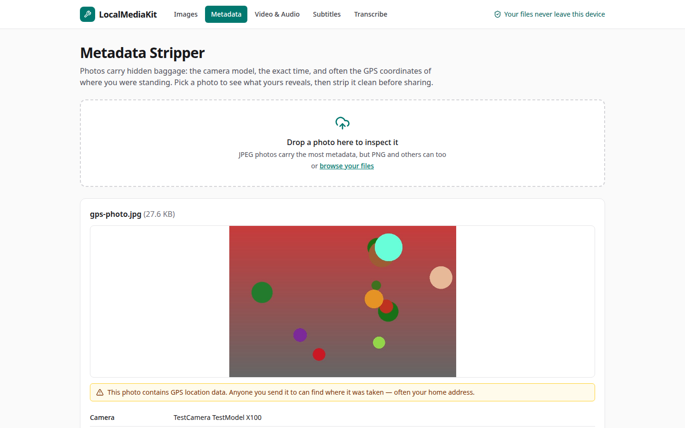
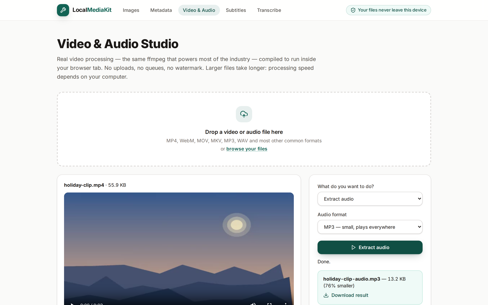

# LocalMediaKit

[](LICENSE)
[](#development)

**Free, private media tools that run 100% in your browser.** Compress, convert, trim and
subtitle photos, videos and audio — a private alternative to Kapwing and the online converter
sites, with no uploads, no accounts, and no file-size upsells. Your files never leave your device.

> Most converter sites work like this: you upload your file, it sits on their server, you wait
> in a queue. LocalMediaKit works like this: the processing happens in this browser tab, on
> your machine. Close the tab and everything is gone.

## Screenshots

<!-- Capture guide: docs/screenshots/README.md — real captures only, please. -->

| Home | Image Studio |
| --- | --- |
|  |  |

| Metadata Stripper | Video & Audio Studio |
| --- | --- |
|  |  |

## The tools

### 🖼️ Image Studio
Batch-compress photos with a quality slider, convert between JPEG / PNG / WebP, and resize
with sensible presets (4K, Full HD, blog, email). See before/after sizes and the savings
percentage per file, download individually, or grab everything as one zip.

### 🛡️ Metadata Stripper
See what a photo reveals about you — camera model, when it was taken, the software that
edited it, and GPS coordinates, with a plain-language warning when location is present.
Strip it all with one click, and verify: the cleaned file is re-read and its (empty)
metadata shown back to you as proof.

### 🎬 Video & Audio Studio
Real ffmpeg, compiled to WebAssembly, running in the tab:

- **Convert** video to MP4 or WebM
- **Compress** with a strong-but-fair preset, optionally capping width
- **Make GIFs** with width, frame-rate and duration controls (proper palette generation)
- **Extract audio** as MP3 or WAV
- **Trim** clips with frame-accurate cuts (re-encoded on purpose — stream copies drift)

### 💬 Subtitle Tools
Convert SRT ↔ WebVTT, shift timings that are out of sync (positive or negative, clamped at
zero), and strip formatting tags (`<i>`, colours, positioning) down to the spoken words.

### 🎙️ Transcribe — Beta
Speech-to-text on your own machine with OpenAI's Whisper (`whisper-tiny.en`) via
Transformers.js. Produces a plain transcript and a downloadable `.srt`. Honestly labelled
Beta: the tiny local model is less accurate than cloud services — it is a good first draft,
not a finished caption file. It loads lazily, only when you open the tool.

## Why local matters

Your photos know where you live. Your recordings contain your voice, your family, your work.
Uploading them to a free converter means trusting a company you have never heard of, in a
jurisdiction you don't know, with copies you can never take back.

Modern browsers can do this work themselves — canvas for images, ffmpeg.wasm for video,
Whisper for speech. LocalMediaKit is just those capabilities, wrapped in an interface your
family could use. There is no backend at all: no database, no storage bucket, nothing to
breach and nothing to leak.

## Quickstart

### Run locally

```bash
npm install
npm run dev
```

Open http://localhost:5173 — the dev server sends the cross-origin-isolation headers the
video engine needs.

### Self-host with Docker

```bash
docker compose up -d
```

Open http://localhost:8080. That's it — one container, no environment variables, no database.

### Deploy anywhere static

`npm run build` produces a plain static site in `dist/`. Any static host works, with one
requirement: the video engine needs these two response headers (nginx and Netlify configs
are included in this repo):

```
Cross-Origin-Opener-Policy: same-origin
Cross-Origin-Embedder-Policy: require-corp
```

Without them the site still loads and every other tool works — the Video Studio explains
the situation and disables itself instead of crashing.

## Architecture

The codebase is deliberately split so the interesting logic is testable without a browser:

```
src/
  lib/          Pure logic + thin browser wrappers
    subtitles.ts      SRT/VTT parser, serialisers, shift & strip (fully unit-tested)
    ffmpegArgs.ts     ffmpeg command builders — pure functions, fully unit-tested
    ffmpegClient.ts   Thin ffmpeg.wasm runner (lazy core load, progress events)
    image.ts          Canvas image pipeline; resize maths is pure + tested
    exif.ts           EXIF → human-friendly rows (pure summariser, tested)
    transcript.ts     Whisper chunks → SRT/text (pure, tested)
    transcriber.ts    Whisper pipeline — dynamic-imported, never in the main bundle
    format.ts         Byte/size/name formatting helpers (tested)
  pages/        One file per tool, mostly UI + state
  components/   Layout, dropzone, small shared UI pieces
```

Two design decisions worth knowing:

1. **ffmpeg arguments are pure functions.** Argument order and filter syntax are where
   video tools quietly go wrong, so builders in `ffmpegArgs.ts` are exhaustively tested
   and the wasm layer just executes what they return.
2. **Heavy things load lazily.** Whisper/Transformers.js (~800 KB of JS, plus the model)
   and the zip library are dynamic imports. Visitors who only compress a photo never
   download them. The ffmpeg core (~32 MB wasm) is served as a static asset and only
   fetched when the first video job runs.

## Development

```bash
npm run test     # 76 unit tests (Vitest) — the lib/ layer
npm run lint     # ESLint
npm run build    # Type-check + production build
```

## Roadmap

**v1.1 ideas** (contributions welcome — see [CONTRIBUTING.md](CONTRIBUTING.md)):

- Image crop and rotate in Image Studio
- Larger Whisper model option for accuracy, with an honest size warning
- Batch subtitle conversion (many files at once)
- Video thumbnails / frame grabs
- PWA offline install polish

## Contributing

Please read [CONTRIBUTING.md](CONTRIBUTING.md) — the short version: privacy is the product,
every tool must actually work, pure logic goes in `lib/` with tests. The
[Code of Conduct](CODE_OF_CONDUCT.md) applies everywhere in the project.

## Licence

[MIT](LICENSE) © LocalMediaKit contributors.

Built with ffmpeg.wasm, React, Vite, exifr, Transformers.js and JSZip — thank you to those
projects. Note: the ffmpeg core is GPL-licensed upstream; if you redistribute a self-hosted
build commercially, check your obligations there.
